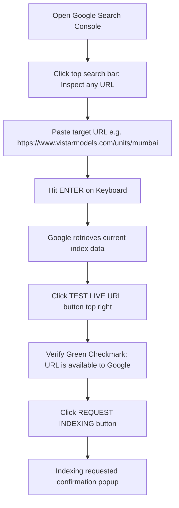

# 02 — Google Search Console (GSC) & Priority Indexing SOP

> This guide provides the complete list of all 39 URLs, daily quota rules, and the step-by-step procedure for using the **URL Inspection Tool** in Google Search Console to achieve immediate indexing.

---

## 📌 Executive Summary

* **Sitemap Status:** Fully processed by Googlebot on 15 Oct 2026.
* **Total Discovered Pages:** 39 URLs.
* **Why URL Inspection is needed:** While Google crawls the sitemap passively over 1–3 days, using the **URL Inspection Tool** forces Google's real-time crawler to evaluate, validate schemas, and index targeted pages within hours.

---

## ⚡ Daily Quota & Golden Rules

1. **Daily Inspection Quota:** Google allows approximately **10 to 15 manual "Request Indexing" submissions per 24 hours** per Search Console property.
2. **Never Spam:** Submitting more than the quota will return a temporary *"Quota exceeded, please try again tomorrow"* message.
3. **Execution Order:** Always inspect and request priority tier URLs first.

---

## 🎯 Priority Matrix: Step-by-Step URL Submission

### 🔴 TIER 1: CRITICAL COMMERCIAL UNITS (Do These First Today)

Submit these 4 URLs immediately in the top search bar:

1. **Mumbai Branch (Top Target)**
   ```text
   https://www.vistarmodels.com/units/mumbai
   ```
2. **Jaipur Branch (Headquarters)**
   ```text
   https://www.vistarmodels.com/units/jaipur
   ```
3. **All Branches Hub**
   ```text
   https://www.vistarmodels.com/units
   ```
4. **Website Homepage**
   ```text
   https://www.vistarmodels.com/
   ```

---

### 🟠 TIER 2: PRIMARY INDUSTRIAL HUBS (Do These Next Today)

5. **Delhi Unit**
   ```text
   https://www.vistarmodels.com/units/delhi
   ```
6. **Gurugram Unit**
   ```text
   https://www.vistarmodels.com/units/gurugram
   ```
7. **Noida Unit**
   ```text
   https://www.vistarmodels.com/units/noida
   ```
8. **Pune Unit**
   ```text
   https://www.vistarmodels.com/units/pune
   ```
9. **Bengaluru Unit**
   ```text
   https://www.vistarmodels.com/units/bengaluru
   ```
10. **Hyderabad Unit**
    ```text
    https://www.vistarmodels.com/units/hyderabad
    ```
11. **Ahmedabad Unit**
    ```text
    https://www.vistarmodels.com/units/ahmedabad
    ```

---

### 🟡 TIER 3: HIGH-INTENT SERVICE CATEGORIES (Do Tomorrow if Quota Exceeded)

12. Architectural Makers: `https://www.vistarmodels.com/architectural-makers`
13. Township Makers: `https://www.vistarmodels.com/township-makers`
14. Industrial Makers: `https://www.vistarmodels.com/industrial-makers`
15. Villa & Commercial Makers: `https://www.vistarmodels.com/villa-commercial-makers`
16. Exhibition Makers: `https://www.vistarmodels.com/exhibition-makers`
17. Engineering Infrastructure: `https://www.vistarmodels.com/engineering-infrastructure-makers`
18. 3D Printing Components: `https://www.vistarmodels.com/3d-printing-components`
19. Working Demonstration: `https://www.vistarmodels.com/working-demonstration-makers`
20. Interior Makers: `https://www.vistarmodels.com/interior-makers`

---

### 🟢 TIER 4: CORE STATIC & BLOG ARTICLES (Googlebot indexes via Sitemap automatically)

21. `https://www.vistarmodels.com/about`
22. `https://www.vistarmodels.com/services`
23. `https://www.vistarmodels.com/find-a-model-maker`
24. `https://www.vistarmodels.com/categories`
25. `https://www.vistarmodels.com/industries`
26. `https://www.vistarmodels.com/how-it-works`
27. `https://www.vistarmodels.com/for-manufacturers`
28. `https://www.vistarmodels.com/become-a-partner`
29. `https://www.vistarmodels.com/faq`
30. `https://www.vistarmodels.com/contact`
31. `https://www.vistarmodels.com/privacy`
32. `https://www.vistarmodels.com/terms`
33. `https://www.vistarmodels.com/blog`
34. `https://www.vistarmodels.com/blog/how-to-choose-an-architectural-model-maker`
35. `https://www.vistarmodels.com/blog/prepare-a-useful-quotation-brief-for-a-scale-model`
36. `https://www.vistarmodels.com/blog/matching-a-model-maker-to-project-capabilities`
37. `https://www.vistarmodels.com/blog/types-of-scale-models-and-their-uses`
38. `https://www.vistarmodels.com/blog/scale-model-timelines-and-budget-considerations`
39. `https://www.vistarmodels.com/blog/what-does-a-scale-model-sourcing-consultancy-do`

---

## 🛠️ Step-by-Step URL Inspection Workflow (In GSC UI)



1. **Locate the bar:** At the very top of Google Search Console, click inside the search bar labeled **"Inspect any URL in 'vistarmodels.com'"**.
2. **Paste & Enter:** Paste the complete URL (always with `https://www.vistarmodels.com/...`). Press **Enter**.
3. **Check live state:** Click the grey button on the top right labeled **"TEST LIVE URL"** (takes ~15 seconds to fetch live code from Vercel).
4. **Submit:** Click the link/button **"REQUEST INDEXING"**.
5. **Repeat:** Move to the next URL in the Tier list.
